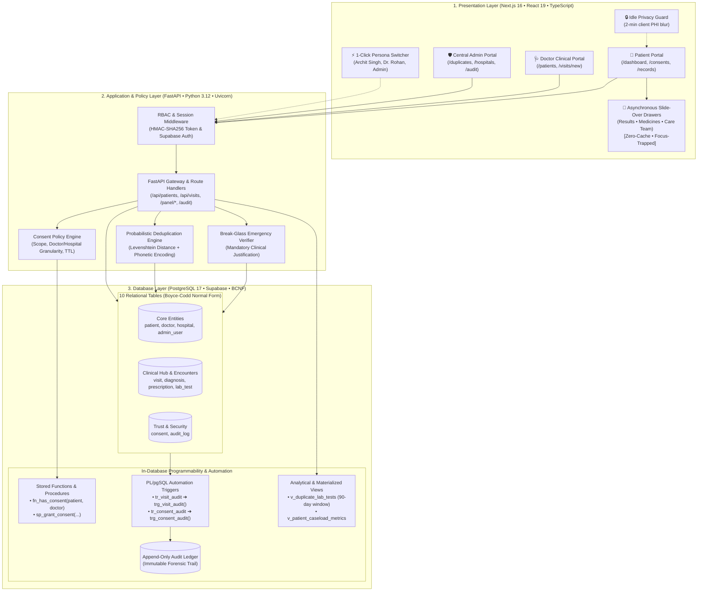

# AarogyaLink System Architecture & Technical Specifications

> **Consent-Driven Multi-Hospital Health Data Sharing Platform**  
> *Database Management Systems (DBMS) Project Architecture Documentation*

---

## 1. High-Level 3-Tier System Architecture



---

## 2. Clinical Data Flow & Consent Lifecycle

```mermaid
sequenceDiagram
    autonumber
    actor Patient as 👤 Patient (Archit Singh)
    actor Doctor as 🩺 Doctor (Dr. Rohan Mehta)
    participant UI as Next.js 16 Frontend
    participant API as FastAPI Backend
    participant Policy as Consent Engine
    participant DB as PostgreSQL 17 Database
    participant Ledger as Audit Log

    %% Consent Phase
    Note over Patient,DB: Phase 1: Consent Granting & Invalidation
    Patient->>UI: Grants 30-day access to Dr. Rohan Mehta
    UI->>API: POST /api/consents
    API->>DB: INSERT INTO consent (doctor_id, patient_id, valid_until)
    DB->>Ledger: Trigger: Log CONSENT_GRANT event

    %% Normal Doctor Query
    Note over Doctor,DB: Phase 2: Doctor Encounters & Verification
    Doctor->>UI: Searches & opens chart for PAT-IN-105001
    UI->>API: GET /api/patients/PAT-IN-105001
    API->>Policy: Check consent status
    Policy->>DB: SELECT fn_has_consent('PAT-IN-105001', 'DOC-01')
    DB-->>Policy: TRUE (Consent Active)
    Policy-->>API: Authorize Read
    API->>DB: Query Visits, Diagnoses, Prescriptions, Labs
    DB-->>API: Return Unified EHR
    API->>Ledger: Append READ access event
    API-->>UI: Render Longitudinal Timeline

    %% Emergency Break-Glass
    Note over Doctor,DB: Phase 3: Emergency Break-Glass (Override)
    Doctor->>UI: Emergency trauma case (Patient unconscious / No consent)
    UI->>API: POST /api/audit/break-glass (reason: "Acute trauma ER override")
    API->>Policy: Validate non-empty justification
    API->>Ledger: Append EMERGENCY_OVERRIDE with justification & timestamp
    API->>DB: Bypass consent barrier; fetch critical vitals & allergies
    DB-->>UI: Unlock Emergency Patient Chart
```

---

## 3. Key Architecture Points to Say (Presentation / Viva)

When explaining this architecture diagram to evaluators or stakeholders, structure your explanation around these **four core pillars**:

### 🏛️ Pillar 1: Presentation Layer (Context-Preserving Clinical UI)
- **Technology Stack:** Next.js 16 (App Router), React 19, TypeScript, Vanilla CSS design system.
- **Key Points to Say:**
  1. *"We chose a server-component hybrid architecture. The UI does not force doctors or patients through nested sub-pages for daily clinical workflows."*
  2. *"Our new **slide-over drawers** fetch lightweight, server-rendered partial HTML fragments directly over HTTP with `cache: 'no-store'`. This guarantees that if a patient revokes consent, a doctor cannot view stale diagnostic data from browser cache memory."*
  3. *"The UI includes an **Idle Privacy Guard** that automatically obscures Protected Health Information (PHI) after 2 minutes of clinician inactivity, protecting against unauthorized room walkthroughs."*

---

### ⚙️ Pillar 2: Application Layer & Policy Engine (Zero-Trust Security)
- **Technology Stack:** FastAPI, Python 3.12, Uvicorn, SQLAlchemy ORM, Pydantic v2.
- **Key Points to Say:**
  1. *"The application tier functions as a **Zero-Trust Policy Enforcement Point (PEP)**. Every request undergoes cryptographic token validation (HMAC-SHA256 session signatures) and Role-Based Access Control (RBAC)."*
  2. *"The **Consent Policy Engine** evaluates two levels of granularity: facility-wide hospital access or individual doctor access, with enforced Time-to-Live (TTL) timestamps."*
  3. *"Our **Break-Glass Emergency Protocol** ensures clinical flexibility: doctors can override consent barriers during life-or-death emergencies, provided they supply an auditable clinical justification."*
  4. *"The **Probabilistic Deduplication Engine** prevents identity duplication across hospitals by executing weighted string metrics (Levenshtein distance) and phonetic algorithms to identify and link fragmented patient profiles."*

---

### 🗄️ Pillar 3: Database Layer (BCNF Normalization & In-Database Logic)
- **Technology Stack:** PostgreSQL 17 (hosted on Supabase Cloud), PL/pgSQL stored procedures, triggers, and analytical views.
- **Key Points to Say:**
  1. *"The database schema is strictly normalized into **Boyce-Codd Normal Form (BCNF)** across 10 tables to eliminate insert, update, and deletion anomalies while maintaining referential integrity across multi-facility encounters."*
  2. *"Access policies are enforced right at the database layer through the stored function `fn_has_consent(patient_id, doctor_id)`. Business logic is not merely frontend-dependent."*
  3. *"Automated **PL/pgSQL triggers (`tr_visit_audit`)** fire autonomously on any data mutation, populating an append-only audit table with actor identity, action type, and timestamps."*
  4. *"Our cross-hospital analytical view `v_duplicate_lab_tests` detects identical laboratory investigations (e.g., HbA1c, Lipid Panels) re-ordered across different hospital networks within a 90-day window, cutting redundant healthcare expenditure."*

---

### 🛡️ Pillar 4: Non-Repudiation & Forensic Audit Ledger
- **Technology Stack:** Relational append-only ledger with cryptographic hash chaining.
- **Key Points to Say:**
  1. *"Unlike traditional applications where logs can be wiped by database administrators, AarogyaLink enforces non-repudiation. Every chart opening, consent modification, drawer expansion, and break-glass override generates an unalterable audit row."*
  2. *"This architectural design delivers complete compliance with Indian ABDM (Ayushman Bharat Digital Mission) guidelines and international HIPAA privacy frameworks without the latency or costs of a blockchain."*

---

## 4. Quick Technical Summary Table

| Architectural Feature | Implementation Mechanism | Benefit / Standard |
|:---|:---|:---|
| **Architectural Pattern** | 3-Tier Enterprise Client-Server | Strict separation of concerns |
| **Relational Normalization** | Boyce-Codd Normal Form (BCNF) | Zero redundancy, high data integrity |
| **In-Database Security** | PL/pgSQL Function `fn_has_consent` | Centralized policy enforcement |
| **Audit Logging** | Event triggers ➔ `audit_log` table | Non-repudiation, tamper-evident forensic history |
| **Emergency Handling** | Break-Glass Protocol | Life-saving clinical override with mandatory accountability |
| **Deduplication** | Levenshtein Distance & Phonetic Matchers | Resolves patient fragmentation across healthcare silos |
| **Contextual Drawers** | Zero-cache server partial rendering | Instant data freshness, WCAG accessible, zero navigation lag |
