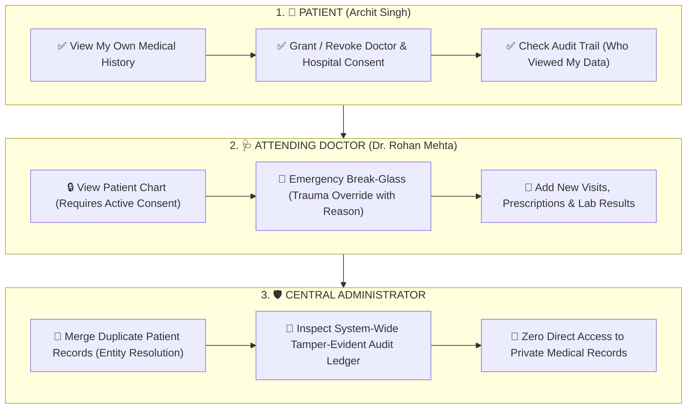

# Role-Based Access Control (RBAC) - Visual Flow

---

### Quick Summary

| Role | Key Permissions | Security Boundary |
|:---|:---|:---|
| **1. 👤 Patient** | View own history, grant/revoke access | Cannot view other patients |
| **2. 🩺 Doctor** | View charts (with consent), add prescriptions, Break-Glass | Blocked without consent or ER override |
| **3. 🛡️ Admin** | Merge duplicate profiles, inspect audit ledger | Cannot view private medical records |
