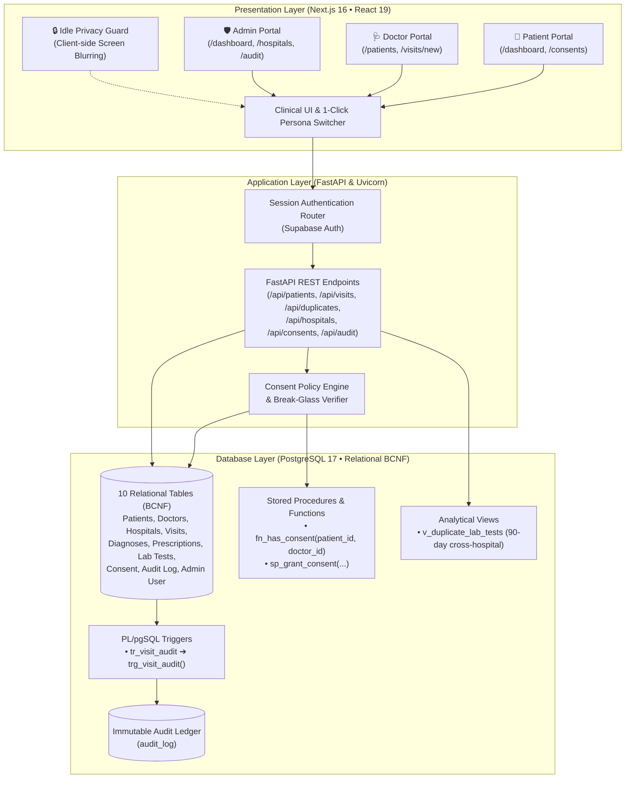
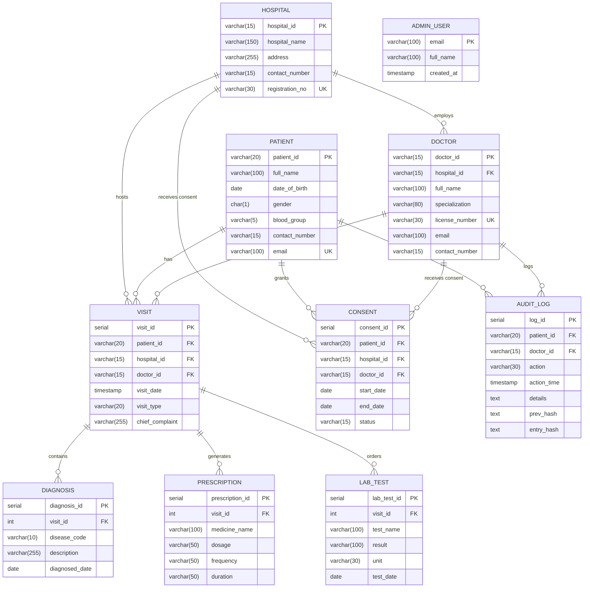

# AarogyaLink (आरोग्यLink)

> **Consent-Driven Multi-Hospital Health Data Sharing Platform**  
> *Database Management Systems (DBMS) — Digital Assignment 02*

---

## 🌟 Overview & Problem Statement

### The Problem
* When a patient visits a new hospital, the attending doctor typically cannot access prior diagnostic history, drug allergies, or active prescriptions.
* Medical records remain fragmented across proprietary hospital silos, traveling as loose paper printouts, emailed PDFs, or folders carried by patients.
* Recent clinical investigations (e.g., Blood tests, ECGs, MRIs) are frequently re-ordered simply because the previous results cannot be retrieved across hospital boundaries.
* ABDM and HL7/FHIR standards exist, but national hospital adoption remains incomplete.

### The Solution: AarogyaLink
AarogyaLink provides a unified digital health data exchange built on a clean, centralized **PostgreSQL 17** relational architecture (BCNF) without blockchain overhead:

1. **One Global Profile:** Every patient receives a unique national identifier (e.g., `PAT-IN-1001` / `PAT100001`). All clinical encounters across affiliated hospitals consolidate into one longitudinal record.
2. **Consent-First Dynamic Authorization:** Patients have sole ownership of their records. They grant or revoke time-bound access at the facility level (hospital-wide) or doctor-specific level via stored database functions (`fn_has_consent`).
3. **Emergency "Break-Glass" Access:** In life-threatening clinical emergencies, doctors can bypass standard consent by supplying mandatory clinical justification, which immediately records an immutable `EMERGENCY_OVERRIDE` entry in the audit ledger.
4. **Cross-Hospital Duplicate Lab Test Detection:** Intelligent analytics automatically flag repeated investigations (e.g., ECG, HbA1c, Serum Creatinine) ordered within a 90-day window across different hospital networks, reducing patient costs and unnecessary procedures.
5. **Idle Privacy Guard:** Built-in client-side inactivity protection automatically blurs sensitive Protected Health Information (PHI) after 2 minutes of idle time.
6. **Immutable Audit Ledger:** Every chart lookup, visit creation, consent adjustment, and emergency override is recorded to an append-only audit trail (`audit_log`) powered by database triggers.

---

## 🏗️ System Architecture (3-Tier Production Stack)

```
Browser (Next.js 16 • React 19)   →   REST API (FastAPI & Uvicorn)   →   Database (PostgreSQL 17 BCNF)
```



---

## 🗄️ Relational Database Design (Boyce-Codd Normal Form)

The database schema is organized into three logical operational domains:
* **People & Facilities:** `patient`, `hospital`, `doctor`, `admin_user`.
* **Clinical Encounters:** `visit` acts as the hub connecting to dependent child tables `diagnosis`, `prescription`, and `lab_test`.
* **Trust & Compliance:** `consent` dictates access policies; `audit_log` records all data access.

### Entity-Relationship Diagram



---

### Relational Schema Summary

| Table | Primary Key | Foreign Keys | Cascade / Restrict | Purpose |
| :--- | :--- | :--- | :--- | :--- |
| `hospital` | `hospital_id` | — | RESTRICT | Accredited hospital network facilities, registration numbers, and addresses. |
| `doctor` | `doctor_id` | `hospital_id` → `hospital` | RESTRICT | Physicians, medical licenses, specializations, and affiliated hospital. |
| `patient` | `patient_id` | — | RESTRICT | Registered citizens with unique emails, masked IDs, and blood groups. |
| `visit` | `visit_id` | `patient_id`, `hospital_id`, `doctor_id` | RESTRICT | Clinical encounter records (`OPD`, `Emergency`, `Inpatient`). |
| `diagnosis` | `diagnosis_id` | `visit_id` → `visit` | **CASCADE** | Clinical ICD-10 diagnosis codes and descriptions. |
| `prescription` | `prescription_id` | `visit_id` → `visit` | **CASCADE** | Formulations, dosages, intake frequencies, and durations. |
| `lab_test` | `lab_test_id` | `visit_id` → `visit` | **CASCADE** | Laboratory diagnostic investigations, units, values, and test dates. |
| `consent` | `consent_id` | `patient_id`, `hospital_id` (opt), `doctor_id` (opt) | RESTRICT | Dynamic time-bound authorization rules (`Active` / `Revoked`). |
| `audit_log` | `log_id` | `patient_id`, `doctor_id` (opt) | SET NULL / RESTRICT | Append-only ledger recording all data access and clinical actions. |
| `admin_user` | `email` | — | RESTRICT | Platform administrative accounts for compliance governance. |

Sign-in uses Supabase Authentication. The browser obtains a Supabase session, then `POST /api/auth/session` maps the email through `GET /api/auth/lookup` onto one role (`patient`, `doctor`, or `admin`) and stores an HMAC-signed httpOnly cookie named `al_session` for 8 hours. Passwords are not stored in the AarogyaLink tables.

---

## ⚡ Stored Procedures, Functions, Triggers & Views

### 1. Dynamic Consent Evaluation (`fn_has_consent`)
Evaluates whether a doctor has active authorization to read a patient's longitudinal health record:
```sql
CREATE OR REPLACE FUNCTION public.fn_has_consent(
    p_patient_id character varying, 
    p_doctor_id character varying
)
RETURNS boolean
LANGUAGE sql
STABLE
AS $$
  SELECT EXISTS (
    SELECT 1
    FROM consent c
    JOIN doctor d ON d.doctor_id = p_doctor_id
    WHERE c.patient_id = p_patient_id
      AND c.status = 'Active'
      AND c.start_date <= (CURRENT_TIMESTAMP AT TIME ZONE 'Asia/Kolkata')::date
      AND (c.end_date IS NULL OR c.end_date >= (CURRENT_TIMESTAMP AT TIME ZONE 'Asia/Kolkata')::date)
      AND (c.doctor_id = p_doctor_id OR c.hospital_id = d.hospital_id)
  );
$$;
```

### 2. Atomic Consent Granting Procedure (`sp_grant_consent`)
Synchronizes ID sequences and inserts active consent records safely:
```sql
CREATE OR REPLACE FUNCTION sp_grant_consent(
  p_patient_id VARCHAR, p_hospital_id VARCHAR, p_doctor_id VARCHAR,
  p_start_date DATE, p_end_date DATE
) RETURNS INTEGER
LANGUAGE plpgsql AS $$
DECLARE new_id INTEGER;
BEGIN
  IF p_hospital_id IS NULL AND p_doctor_id IS NULL THEN
    RAISE EXCEPTION 'Consent must name a hospital or a doctor';
  END IF;

  PERFORM setval('consent_consent_id_seq', (SELECT COALESCE(MAX(consent_id), 0) + 1 FROM consent), false);

  INSERT INTO consent (patient_id, hospital_id, doctor_id, start_date, end_date, status)
  VALUES (p_patient_id, p_hospital_id, p_doctor_id, p_start_date, p_end_date, 'Active')
  RETURNING consent_id INTO new_id;
  RETURN new_id;
END;
$$;
```

### 3. Automated Clinical Audit Trigger (`tr_visit_audit`)
Guarantees that every newly recorded clinical encounter is immediately captured in the append-only audit ledger:
```sql
CREATE OR REPLACE FUNCTION trg_visit_audit() RETURNS TRIGGER
LANGUAGE plpgsql AS $$
BEGIN
  INSERT INTO audit_log (patient_id, doctor_id, action, details)
  VALUES (
    NEW.patient_id, NEW.doctor_id, 'INSERT',
    format('visit_id=%s type=%s hospital=%s', NEW.visit_id, NEW.visit_type, NEW.hospital_id)
  );
  RETURN NEW;
END;
$$;

CREATE TRIGGER tr_visit_audit
AFTER INSERT ON visit
FOR EACH ROW EXECUTE FUNCTION trg_visit_audit();
```

### 4. Cross-Hospital Duplicate Lab Test Analytical View (`v_duplicate_lab_tests`)
Identifies identical laboratory investigations conducted on the same patient across different hospitals within a 90-day window:
```sql
CREATE OR REPLACE VIEW v_duplicate_lab_tests AS
SELECT 
    lt1.lab_test_id AS initial_test_id,
    lt1.test_name,
    lt1.test_date AS initial_date,
    v1.patient_id,
    v1.hospital_id AS initial_hospital_id,
    lt2.lab_test_id AS duplicate_test_id,
    lt2.test_date AS duplicate_date,
    v2.hospital_id AS duplicate_hospital_id,
    (lt2.test_date - lt1.test_date) AS days_between
FROM lab_test lt1
JOIN visit v1 ON lt1.visit_id = v1.visit_id
JOIN lab_test lt2 ON lt1.test_name = lt2.test_name AND lt1.lab_test_id < lt2.lab_test_id
JOIN visit v2 ON lt2.visit_id = v2.visit_id AND v1.patient_id = v2.patient_id
WHERE v1.hospital_id <> v2.hospital_id
  AND lt2.test_date >= lt1.test_date
  AND lt2.test_date - lt1.test_date <= 90;
```

### 5. Indexing and Query Optimization
B-Tree indexes targeting the high-frequency query and chart-assembly paths:
```sql
-- Initial migration indexes (init_migration_001.sql)
CREATE INDEX IF NOT EXISTS idx_visit_patient ON visit(patient_id);
CREATE INDEX IF NOT EXISTS idx_consent_patient_status ON consent(patient_id, status);
CREATE INDEX IF NOT EXISTS idx_lab_test_name_date ON lab_test(test_name, test_date);
CREATE INDEX IF NOT EXISTS idx_audit_patient_time ON audit_log(patient_id, action_time DESC);

-- Chart load & temporal composite indexes (perf_and_audit.sql)
CREATE INDEX IF NOT EXISTS idx_diagnosis_visit ON diagnosis(visit_id);
CREATE INDEX IF NOT EXISTS idx_prescription_visit ON prescription(visit_id);
CREATE INDEX IF NOT EXISTS idx_lab_test_visit ON lab_test(visit_id);
CREATE INDEX IF NOT EXISTS idx_visit_patient_date ON visit(patient_id, visit_date DESC);
```

#### Query Execution Benchmark (Supabase PostgreSQL snapshot — 701 patients, 1,324 visits)
Measured via `EXPLAIN (ANALYZE, FORMAT JSON)` across 40 iterations (median):

| Query Workflow | Without Indexes | With Indexes | Latency Speed-up | Execution Plan with Indexes |
| :--- | :---: | :---: | :---: | :--- |
| **Patient Timeline Lookup** | 0.211 ms | 0.083 ms | **2.5×** | Index Scan on `idx_visit_patient` |
| **Active Patient Consents** | 0.378 ms | 0.058 ms | **6.5×** | Bitmap Index Scan on `idx_consent_patient_status` |
| **Duplicate Lab Test View** | 3.915 ms | 3.798 ms | 1.0× | Sequential scans + Hash joins across hospitals |
| **Audit Trail Retrieval** | 0.550 ms | 0.045 ms | **12.2×** | Index Scan on `idx_audit_patient_time` |

---

### 6. Append-Only Cryptographic Hash Chaining (`perf_and_audit.sql`)
To ensure complete non-repudiation and tamper evidence without the throughput limits of blockchain, `audit_log` is sealed with SHA-256 hash chaining:

```sql
-- Hash chain extension
ALTER TABLE audit_log ADD COLUMN IF NOT EXISTS prev_hash TEXT;
ALTER TABLE audit_log ADD COLUMN IF NOT EXISTS entry_hash TEXT;

-- Cryptographic sealing trigger (runs on BEFORE INSERT)
CREATE OR REPLACE FUNCTION trg_audit_seal() RETURNS TRIGGER
LANGUAGE plpgsql AS $$
DECLARE
    prev TEXT;
    payload TEXT;
BEGIN
    PERFORM pg_advisory_xact_lock(871234);
    SELECT entry_hash INTO prev FROM audit_log ORDER BY log_id DESC LIMIT 1;
    NEW.prev_hash := COALESCE(prev, 'GENESIS');
    payload := concat_ws('|', COALESCE(NEW.patient_id, ''), COALESCE(NEW.doctor_id, ''),
                         COALESCE(NEW.action, ''), COALESCE(NEW.action_time::text, ''),
                         COALESCE(NEW.details, ''), NEW.prev_hash);
    NEW.entry_hash := encode(sha256(convert_to(payload, 'UTF8')), 'hex');
    RETURN NEW;
END;
$$;

-- Immutability guard (rejects any UPDATE or DELETE)
CREATE OR REPLACE FUNCTION trg_audit_immutable() RETURNS TRIGGER
LANGUAGE plpgsql AS $$
BEGIN
    RAISE EXCEPTION 'audit_log is append-only';
END;
$$;

CREATE TRIGGER tr_audit_seal BEFORE INSERT ON audit_log FOR EACH ROW EXECUTE FUNCTION trg_audit_seal();
CREATE TRIGGER tr_audit_immutable BEFORE UPDATE OR DELETE ON audit_log FOR EACH ROW EXECUTE FUNCTION trg_audit_immutable();
```

---

## 👥 Security & Role-Based Access Control (RBAC)

AarogyaLink enforces strict separation of concerns across three distinct user roles:

1. **Patient (Data Owner):**
   * Inspects complete longitudinal medical records (visits, diagnoses, lab investigations, medications).
   * Grants or revokes time-bound dynamic consent (hospital-wide or doctor-specific).
   * Reviews personal audit history to observe exactly which doctors accessed their chart and when.
2. **Doctor (Clinical Provider):**
   * Searches patient directory; reads patient medical charts **only** when active consent exists (`fn_has_consent = true`).
   * Records clinical visits, chief complaints, ICD-10 diagnoses, medications, and laboratory tests.
   * Receives real-time advisory alerts when ordering a duplicate lab test recently conducted at another facility.
   * Can trigger audited emergency **Break-Glass access** if no consent exists during urgent care.
3. **Administrator (Platform Compliance Officer):**
   * Monitors network-wide statistics (50 hospitals, 700+ patients, 1,300+ visits, 2,800+ consents).
   * Analyzes operational hospital caseload distributions (OPD vs. Emergency vs. Inpatient).
   * Inspects live system audit trails and emergency access override justifications.

---

## 🚀 How to Run the Project

The only database is the hosted Supabase PostgreSQL project. Apply the SQL files in the Supabase SQL editor in this order:

1. `database/init_migration_001.sql` (10 core BCNF tables, views, triggers, and functions)
2. `database/initial_mock_data_load_fixed.sql` (Benchmark dataset: 50 hospitals, 701 patients, 1,324 visits)
3. `database/seed_demo_consents.sql` (Persona consents and doctor affiliations)
4. `database/rls_policies.sql` (Strict Row Level Security enabled and forced on all 10 tables)
5. `database/perf_and_audit.sql` (Chart-load composite indexes and SHA-256 append-only seal)
6. `database/check_rls.sql` (Security & RLS verification audit)

### Method 1: Docker Compose (demo)

`docker-compose.yml` starts the Next.js frontend and the FastAPI backend. Both talk to Supabase. Authentication is Supabase Auth.

```bash
docker compose up -d --build
```

#### Endpoints:
* **Frontend Web App:** [http://localhost:3000](http://localhost:3000)
* **Backend REST API:** [http://localhost:8000](http://localhost:8000)
* **API Documentation:** [http://localhost:8000/docs](http://localhost:8000/docs) or [http://localhost:8000/redoc](http://localhost:8000/redoc)
* **Health:** [http://localhost:8000/health](http://localhost:8000/health)

Stop the containers with `docker compose down`. Schema and seed data stay in Supabase.

---

### Method 2: App processes on the host, database on Supabase

Use this when you want FastAPI reload and Next.js hot reload. Set `DATABASE_URL` to the Supabase pooler connection string (`postgresql+psycopg://...`). Set `NEXT_PUBLIC_SUPABASE_URL` and `NEXT_PUBLIC_SUPABASE_ANON_KEY` to the project URL and publishable key. Do not commit those values.

```bash
cd backend
# PowerShell: $env:DATABASE_URL = "<supabase connection string>"
python -m uvicorn main:app --reload --port 8000
```

```bash
cd frontend
npm install
npm run dev
```

Open [http://localhost:3000](http://localhost:3000).

---

### Method 3: Offline frontend preview

If Supabase and the API are unavailable, the Next.js app can render from an in-memory sample store. That preview does not read or write PostgreSQL.

```bash
cd frontend
npm install
npm run dev
```

---

## 🔑 Demo Personas & Test Credentials

The login screen features **1-Click Instant Persona Logins** pre-configured for evaluation:

| Role | Persona Name | Email | Password | Pre-configured Access & Privileges |
| :--- | :--- | :--- | :--- | :--- |
| **Patient** | Archit Singh | `archit@gmail.com` | `AarogyaLink@123` | Patient ID `PAT-IN-105001`. Longitudinal history across Apollo, Fortis, and AIIMS; consents and prescriptions walkthrough. |
| **Patient** | Karthik Iyer | `karthik.iyer@example.in` | `AarogyaLink@123` | Patient ID `PAT-IN-1002`. Longitudinal record, consents, and access log. |
| **Patient** | Devansh Gupta | `devansh.gupta@example.in` | `AarogyaLink@123` | Patient ID `PAT-IN-1006`. Chart used for the blocked-access and break-glass demo. |
| **Patient** | Meera Nair | `meera.nair@example.in` | `AarogyaLink@123` | Patient ID `PAT-IN-1005`. Active medicines and remaining course days. |
| **Doctor** | Dr. Rohan Mehta | `rohan.mehta@example.in` | `AarogyaLink@123` | Doctor ID `DOC-01`. Cardiology at Apollo Hospitals (`HSP1001`). |
| **Doctor** | Dr. Nisha Kapoor | `nisha.kapoor@example.in` | `AarogyaLink@123` | Doctor ID `DOC-04`. Internal Medicine at Fortis (`HSP1002`). |
| **Doctor** | Dr. Vikram Sharma | `vikram.sharma@example.in` | `AarogyaLink@123` | Doctor ID `DOC-05`. Orthopedics at AIIMS (`HSP1005`). |
| **Administrator** | Central Administrator | `admin@arogyalink.in` | `AarogyaLink@123` | Network overview, hospital caseload, duplicate lab tests, and the audit trail. |

---

## 📊 Pre-Loaded Benchmark Dataset

The database seeds a national multi-hospital healthcare network across major Indian metro centers:

* **50 Accredited Hospitals:** Apollo Hospitals, Fortis Healthcare, AIIMS, Medanta, Manipal, Tata Memorial, Christian Medical College, Narayana Health, and more.
* **300+ Registered Physicians:** General Physicians, Cardiologists, Oncologists, Neurologists, Pulmonologists, Pediatricians.
* **700+ Registered Patients:** Demographic diversity with masked identifiers, unique contacts, and blood groups.
* **1,300+ Clinical Encounters:** Realistic OPD, Emergency, and Inpatient encounter records.
* **2,800+ Active / Historical Consents:** Facility-wide and doctor-specific authorization rules.
* **5,000+ Audit Log Entries:** Complete tracking of data views, record creations, consent modifications, and emergency overrides.

---

## 📁 Repository Structure

```
arogya-link/
├── README.md                      # Complete system documentation (this file)
├── docker-compose.yml             # Frontend and backend; database is Supabase
├── database/
│   ├── init_migration_001.sql     # Core BCNF Schema (10 tables, views, functions, triggers, indexes)
│   ├── initial_mock_data_load_fixed.sql # Seed dataset (50 hospitals, 701 patients, 1,324 visits)
│   ├── seed_demo_consents.sql     # Demo patient consents, doctor associations & sequence fix
│   ├── rls_policies.sql           # Row Level Security policies for production hardening
│   ├── perf_and_audit.sql         # Chart-load composite indexes & SHA-256 append-only seal
│   └── check_rls.sql              # Security audit verification script
├── frontend/                      # Next.js 16 Web Application (App Router, React 19)
│   ├── src/
│   │   ├── app/                   # App Router pages (/dashboard, /consents, /patients, /hospitals, /audit)
│   │   ├── components/            # UI Components (IdleGuard, VisitForm, AuthCard, ThemeToggle, etc.)
│   │   └── lib/                   # REST API client, session management, in-memory store
│   ├── Dockerfile                 # Multi-stage optimized production build (Node 22 standalone)
│   └── package.json               # Next.js 16.4.2 & React 19.3.0
├── backend/                       # FastAPI Python REST Application (31 paths, 38 operations)
│   ├── main.py                    # API entry point, CORS configuration, route inclusion
│   ├── requirements.txt           # FastAPI, Uvicorn, SQLAlchemy 2.0, Psycopg 3
│   ├── Dockerfile                 # Python 3.12-slim container specification
│   └── src/
│       ├── core/                  # Database engines and connection pooling
│       ├── models/                # SQLAlchemy ORM models matching BCNF tables
│       └── routers/               # 9 routers: patients, visits, duplicates, consents, hospitals, audit, auth, doctors, stats
└── docs/                          # Detailed DBMS assignment reports & SQL queries
    ├── SLIDE_EXPLANATIONS.md      # Comprehensive slide-by-slide presentation & viva guide
    ├── DATABASE_SCHEMA.md         # Comprehensive schema & data dictionary
    └── AarogyaLink_DA2_SQL_Queries.md # Complete raw SQL queries for assignment evaluation
```

---

## 🔮 Future Scope
* **ABDM & HL7/FHIR Integration:** Full interoperability with Ayushman Bharat Digital Mission (ABDM) and standard FHIR resource mapping.
* **Multi-Factor OTP Consent:** Real-time SMS/WhatsApp OTP authorization when a doctor requests emergency access outside pre-existing consent.
* **External Timestamp Notarization:** Periodically publish SHA-256 audit-chain root anchors to external public timestamp authorities.
* **Field-Level Encryption at Rest:** pgcrypto-based column encryption for sensitive diagnostic descriptions and clinical notes.
