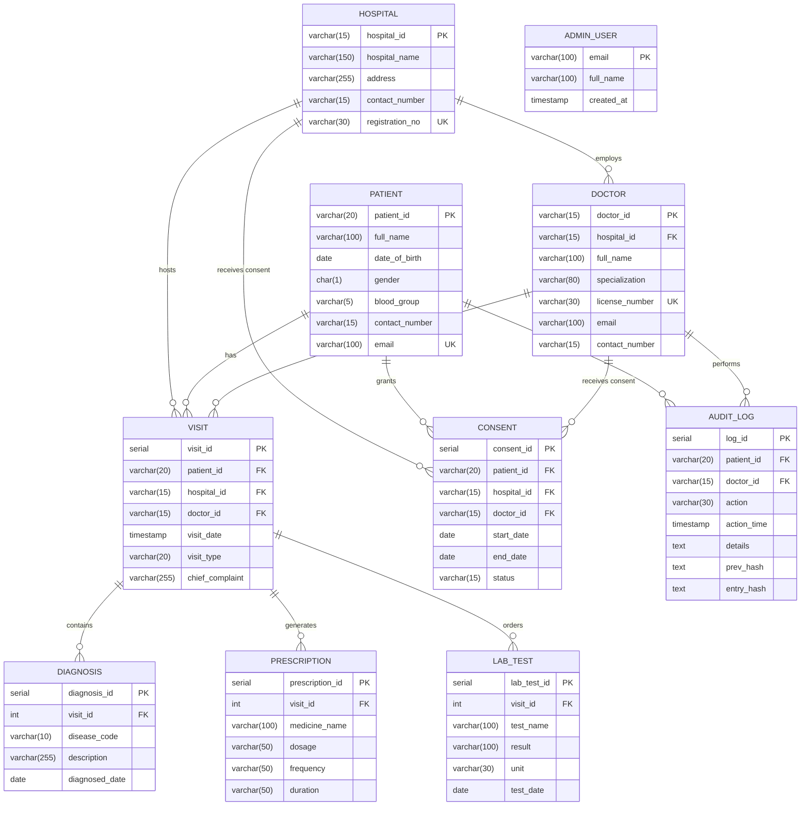

# AarogyaLink — Database Schema & Architecture Reference

This document provides the complete database schema, entity-relationship models, constraints, views, triggers, and relationship linkages for **AarogyaLink** — a federated, multi-hospital health data sharing platform.

---

## 1. Entity-Relationship Diagram (ERD)



---

## 2. Table Schemas & Data Dictionaries

### 2.1. `patient`
Stores globally unique patient master records. Patients own their health record and govern consent.

| Column | Type | Constraints | Description |
| :--- | :--- | :--- | :--- |
| `patient_id` | `VARCHAR(20)` | **PRIMARY KEY** | Unique global identifier (e.g. `PAT-IN-1001`) |
| `full_name` | `VARCHAR(100)` | `NOT NULL` | Patient's full legal name |
| `date_of_birth` | `DATE` | `NOT NULL` | Date of birth for age derivation |
| `gender` | `CHAR(1)` | `NOT NULL`, `CHECK (gender IN ('M', 'F', 'O'))` | Biological sex / gender identifier |
| `blood_group` | `VARCHAR(5)` | Nullable | Blood group (e.g., `A+`, `O-`, `B+`) |
| `contact_number`| `VARCHAR(15)` | `NOT NULL` | 10–15 digit mobile phone number |
| `email` | `VARCHAR(100)` | **UNIQUE**, Nullable | Email address for portal login & alerts |

```sql
CREATE TABLE patient (
  patient_id     VARCHAR(20)  PRIMARY KEY,
  full_name      VARCHAR(100) NOT NULL,
  date_of_birth  DATE         NOT NULL,
  gender         CHAR(1)      NOT NULL CHECK (gender IN ('M', 'F', 'O')),
  blood_group    VARCHAR(5),
  contact_number VARCHAR(15)  NOT NULL,
  email          VARCHAR(100) UNIQUE
);
```

---

### 2.2. `hospital`
Stores institutional entities participating in the AarogyaLink health data federation.

| Column | Type | Constraints | Description |
| :--- | :--- | :--- | :--- |
| `hospital_id` | `VARCHAR(15)` | **PRIMARY KEY** | Unique facility identifier (e.g. `HSP-01`) |
| `hospital_name` | `VARCHAR(150)` | `NOT NULL` | Hospital or clinic system name |
| `address` | `VARCHAR(255)` | `NOT NULL` | Physical facility street address & city |
| `contact_number`| `VARCHAR(15)` | `NOT NULL` | Facility telephone / PBX board number |
| `registration_no`| `VARCHAR(30)` | **UNIQUE**, `NOT NULL` | Government regulatory license / registration |

```sql
CREATE TABLE hospital (
  hospital_id     VARCHAR(15)  PRIMARY KEY,
  hospital_name   VARCHAR(150) NOT NULL,
  address         VARCHAR(255) NOT NULL,
  contact_number  VARCHAR(15)  NOT NULL,
  registration_no VARCHAR(30)  UNIQUE NOT NULL
);
```

---

### 2.3. `doctor`
Stores credentialed clinicians affiliated with hospitals.

| Column | Type | Constraints | Description |
| :--- | :--- | :--- | :--- |
| `doctor_id` | `VARCHAR(15)` | **PRIMARY KEY** | Unique physician identifier (e.g. `DOC-01`) |
| `hospital_id` | `VARCHAR(15)` | `NOT NULL`, **REFERENCES** `hospital(hospital_id)` | Primary affiliated hospital |
| `full_name` | `VARCHAR(100)` | `NOT NULL` | Physician's full name |
| `specialization`| `VARCHAR(80)` | `NOT NULL` | Medical department / specialty |
| `license_number`| `VARCHAR(30)` | **UNIQUE**, `NOT NULL` | State/National Medical Council registration |
| `email` | `VARCHAR(100)` | Nullable | Clinician email |
| `contact_number`| `VARCHAR(15)` | Nullable | Direct contact number |

```sql
CREATE TABLE doctor (
  doctor_id      VARCHAR(15)  PRIMARY KEY,
  hospital_id    VARCHAR(15)  NOT NULL REFERENCES hospital(hospital_id),
  full_name      VARCHAR(100) NOT NULL,
  specialization VARCHAR(80)  NOT NULL,
  license_number VARCHAR(30)  UNIQUE NOT NULL,
  email          VARCHAR(100),
  contact_number VARCHAR(15)
);
```

---

### 2.4. `visit`
The central encounter hub linking the patient, attending clinician, and host hospital.

| Column | Type | Constraints | Description |
| :--- | :--- | :--- | :--- |
| `visit_id` | `SERIAL` | **PRIMARY KEY** | Auto-incrementing encounter sequence ID |
| `patient_id` | `VARCHAR(20)` | `NOT NULL`, **REFERENCES** `patient(patient_id)` | Patient who attended the visit |
| `hospital_id` | `VARCHAR(15)` | `NOT NULL`, **REFERENCES** `hospital(hospital_id)` | Hospital facility where visit occurred |
| `doctor_id` | `VARCHAR(15)` | `NOT NULL`, **REFERENCES** `doctor(doctor_id)` | Treating physician |
| `visit_date` | `TIMESTAMP` | `NOT NULL DEFAULT NOW()` | Date and timestamp of the encounter |
| `visit_type` | `VARCHAR(20)` | `NOT NULL`, `CHECK (visit_type IN ('OPD', 'Emergency', 'Inpatient'))` | Encounter classification |
| `chief_complaint`| `VARCHAR(255)`| Nullable | Presenting medical problem |

```sql
CREATE TABLE visit (
  visit_id        SERIAL      PRIMARY KEY,
  patient_id      VARCHAR(20) NOT NULL REFERENCES patient(patient_id),
  hospital_id     VARCHAR(15) NOT NULL REFERENCES hospital(hospital_id),
  doctor_id       VARCHAR(15) NOT NULL REFERENCES doctor(doctor_id),
  visit_date      TIMESTAMP   NOT NULL DEFAULT NOW(),
  visit_type      VARCHAR(20) NOT NULL CHECK (visit_type IN ('OPD', 'Emergency', 'Inpatient')),
  chief_complaint VARCHAR(255)
);
```

---

### 2.5. `diagnosis`
Diagnostic records tied directly to a clinical visit.

| Column | Type | Constraints | Description |
| :--- | :--- | :--- | :--- |
| `diagnosis_id` | `SERIAL` | **PRIMARY KEY** | Auto-incrementing diagnosis ID |
| `visit_id` | `INTEGER` | `NOT NULL`, **REFERENCES** `visit(visit_id) ON DELETE CASCADE` | Parent clinical visit |
| `disease_code` | `VARCHAR(10)` | `NOT NULL` | Standard ICD-10 diagnostic code (e.g. `E11.9`) |
| `description` | `VARCHAR(255)`| `NOT NULL` | Clinical description of diagnosis |
| `diagnosed_date`| `DATE` | `NOT NULL` | Date diagnosis was confirmed |

```sql
CREATE TABLE diagnosis (
  diagnosis_id   SERIAL       PRIMARY KEY,
  visit_id       INTEGER      NOT NULL REFERENCES visit(visit_id) ON DELETE CASCADE,
  disease_code   VARCHAR(10)  NOT NULL,
  description    VARCHAR(255) NOT NULL,
  diagnosed_date DATE         NOT NULL
);
```

---

### 2.6. `prescription`
Medications prescribed during an encounter.

| Column | Type | Constraints | Description |
| :--- | :--- | :--- | :--- |
| `prescription_id`| `SERIAL` | **PRIMARY KEY** | Auto-incrementing prescription ID |
| `visit_id` | `INTEGER` | `NOT NULL`, **REFERENCES** `visit(visit_id) ON DELETE CASCADE` | Parent clinical visit |
| `medicine_name`| `VARCHAR(100)`| `NOT NULL` | Drug brand/generic name |
| `dosage` | `VARCHAR(50)` | `NOT NULL` | Dosage strength (e.g. `500 mg`, `10 mg`) |
| `frequency` | `VARCHAR(50)` | `NOT NULL` | Administration schedule (e.g. `Twice daily after meals`) |
| `duration` | `VARCHAR(50)` | `NOT NULL` | Treatment duration (e.g. `14 days`, `30 days`) |

```sql
CREATE TABLE prescription (
  prescription_id SERIAL       PRIMARY KEY,
  visit_id        INTEGER      NOT NULL REFERENCES visit(visit_id) ON DELETE CASCADE,
  medicine_name   VARCHAR(100) NOT NULL,
  dosage          VARCHAR(50)  NOT NULL,
  frequency       VARCHAR(50)  NOT NULL,
  duration        VARCHAR(50)  NOT NULL
);
```

---

### 2.7. `lab_test`
Diagnostic laboratory investigations and findings.

| Column | Type | Constraints | Description |
| :--- | :--- | :--- | :--- |
| `lab_test_id` | `SERIAL` | **PRIMARY KEY** | Auto-incrementing lab result ID |
| `visit_id` | `INTEGER` | `NOT NULL`, **REFERENCES** `visit(visit_id) ON DELETE CASCADE` | Parent clinical visit |
| `test_name` | `VARCHAR(100)`| `NOT NULL` | Investigation name (e.g. `HbA1c`, `Serum Creatinine`) |
| `result` | `VARCHAR(100)`| Nullable | Numerical or qualitative result |
| `unit` | `VARCHAR(30)` | Nullable | Measurement unit (e.g. `mg/dL`, `%`) |
| `test_date` | `DATE` | `NOT NULL` | Date specimen was tested |

```sql
CREATE TABLE lab_test (
  lab_test_id SERIAL       PRIMARY KEY,
  visit_id    INTEGER      NOT NULL REFERENCES visit(visit_id) ON DELETE CASCADE,
  test_name   VARCHAR(100) NOT NULL,
  result      VARCHAR(100),
  unit        VARCHAR(30),
  test_date   DATE         NOT NULL
);
```

---

### 2.8. `consent`
Governs dynamic, patient-controlled data sharing permissions across hospitals and clinicians.

| Column | Type | Constraints | Description |
| :--- | :--- | :--- | :--- |
| `consent_id` | `SERIAL` | **PRIMARY KEY** | Auto-incrementing consent policy ID |
| `patient_id` | `VARCHAR(20)` | `NOT NULL`, **REFERENCES** `patient(patient_id)` | Granting patient |
| `hospital_id` | `VARCHAR(15)` | Nullable, **REFERENCES** `hospital(hospital_id)` | Target hospital (grants all doctors at hospital) |
| `doctor_id` | `VARCHAR(15)` | Nullable, **REFERENCES** `doctor(doctor_id)` | Specific target doctor |
| `start_date` | `DATE` | `NOT NULL` | Effective start date |
| `end_date` | `DATE` | Nullable | Expiry date (`NULL` = indefinite until revoked) |
| `status` | `VARCHAR(15)` | `NOT NULL`, `CHECK (status IN ('Active', 'Revoked'))` | Current consent state |

**Domain Constraints:**
- `CHECK (hospital_id IS NOT NULL OR doctor_id IS NOT NULL)`: Must target either a facility or an individual physician.
- `CHECK (end_date IS NULL OR end_date >= start_date)`: End date cannot precede start date.

```sql
CREATE TABLE consent (
  consent_id  SERIAL      PRIMARY KEY,
  patient_id  VARCHAR(20) NOT NULL REFERENCES patient(patient_id),
  hospital_id VARCHAR(15) REFERENCES hospital(hospital_id),
  doctor_id   VARCHAR(15) REFERENCES doctor(doctor_id),
  start_date  DATE        NOT NULL,
  end_date    DATE,
  status      VARCHAR(15) NOT NULL CHECK (status IN ('Active', 'Revoked')),
  CHECK (hospital_id IS NOT NULL OR doctor_id IS NOT NULL),
  CHECK (end_date IS NULL OR end_date >= start_date)
);
```

---

### 2.9. `audit_log`
Immutable, tamper-evident audit ledger capturing every access attempt, chart read, visit insert, and emergency "break-glass" override.

| Column | Type | Constraints | Description |
| :--- | :--- | :--- | :--- |
| `log_id` | `SERIAL` | **PRIMARY KEY** | Auto-incrementing audit sequence ID |
| `patient_id` | `VARCHAR(20)` | `NOT NULL`, **REFERENCES** `patient(patient_id)` | Patient record accessed |
| `doctor_id` | `VARCHAR(15)` | Nullable, **REFERENCES** `doctor(doctor_id)` | Clinician initiating the action |
| `action` | `VARCHAR(30)` | `NOT NULL` | `READ`, `INSERT`, `EMERGENCY_READ`, `DENIED`, etc. |
| `action_time` | `TIMESTAMP` | `NOT NULL DEFAULT NOW()` | Tamper-proof transaction timestamp |
| `details` | `TEXT` | Nullable | Contextual information or emergency justification |
| `prev_hash` | `TEXT` | Nullable | SHA-256 hash of preceding row (blockchain link) |
| `entry_hash` | `TEXT` | Nullable | SHA-256 seal of current row payload + `prev_hash` |

```sql
CREATE TABLE audit_log (
  log_id      SERIAL      PRIMARY KEY,
  patient_id  VARCHAR(20) NOT NULL REFERENCES patient(patient_id),
  doctor_id   VARCHAR(15) REFERENCES doctor(doctor_id),
  action      VARCHAR(30) NOT NULL,
  action_time TIMESTAMP   NOT NULL DEFAULT NOW(),
  details     TEXT,
  prev_hash   TEXT,
  entry_hash  TEXT
);
```

---

### 2.10. `admin_user`
Central platform administrators with network-wide compliance oversight.

| Column | Type | Constraints | Description |
| :--- | :--- | :--- | :--- |
| `email` | `VARCHAR(100)` | **PRIMARY KEY** | Unique administrative login email |
| `full_name` | `VARCHAR(100)` | `NOT NULL` | Full name of administrator |
| `created_at` | `TIMESTAMP` | `NOT NULL DEFAULT NOW()` | Account creation timestamp |

```sql
CREATE TABLE admin_user (
  email      VARCHAR(100) PRIMARY KEY,
  full_name  VARCHAR(100) NOT NULL,
  created_at TIMESTAMP    NOT NULL DEFAULT NOW()
);
```

---

## 3. How the Tables Are Linked

```
             ┌──────────────┐
             │   HOSPITAL   │
             └──────┬───────┘
                    │ 1
                    │
                    │ N
             ┌──────▼───────┐             ┌──────────────┐
             │    DOCTOR    │             │   PATIENT    │
             └──────┬───────┘             └──────┬───────┘
                    │ 1                          │ 1
                    │                            │
                    └───────────┬────────────────┘
                                │
                                │ N
                         ┌──────▼───────┐
                         │    VISIT     │
                         └──┬───┬───┬───┘
                            │   │   │
               ┌────────────┘   │   └────────────┐
             1 │              1 │              1 │
               │ N              │ N              │ N
        ┌──────▼───────┐ ┌──────▼───────┐ ┌──────▼───────┐
        │  DIAGNOSIS   │ │ PRESCRIPTION │ │   LAB_TEST   │
        └──────────────┘ └──────────────┘ └──────────────┘

  Cross-Cutting Governance:
  - CONSENT: Linked to PATIENT (1:N), optionally to HOSPITAL (0..1) or DOCTOR (0..1)
  - AUDIT_LOG: Linked to PATIENT (1:N), optionally to DOCTOR (0..1)
```

### Relational Linkage Summary

| Child Table | Foreign Key Column | Parent Table | Reference Column | Delete Rule | Business Meaning |
| :--- | :--- | :--- | :--- | :--- | :--- |
| `doctor` | `hospital_id` | `hospital` | `hospital_id` | RESTRICT | A doctor belongs to a verified hospital. |
| `visit` | `patient_id` | `patient` | `patient_id` | RESTRICT | A clinical encounter is tied to a unique patient. |
| `visit` | `hospital_id` | `hospital` | `hospital_id` | RESTRICT | Encounters take place at a specific hospital facility. |
| `visit` | `doctor_id` | `doctor` | `doctor_id` | RESTRICT | Encounters are conducted by a treating doctor. |
| `diagnosis` | `visit_id` | `visit` | `visit_id` | **CASCADE** | Diagnoses recorded during an encounter. Deleted if visit purged. |
| `prescription` | `visit_id` | `visit` | `visit_id` | **CASCADE** | Medications ordered during an encounter. Deleted if visit purged. |
| `lab_test` | `visit_id` | `visit` | `visit_id` | **CASCADE** | Lab tests performed for an encounter. Deleted if visit purged. |
| `consent` | `patient_id` | `patient` | `patient_id` | RESTRICT | Patient governs who can view their longitudinal records. |
| `consent` | `hospital_id` | `hospital` | `hospital_id` | RESTRICT | Optional broad consent granting all doctors at that facility. |
| `consent` | `doctor_id` | `doctor` | `doctor_id` | RESTRICT | Optional narrow consent granting a specific specialist. |
| `audit_log` | `patient_id` | `patient` | `patient_id` | RESTRICT | Every record inspection or update leaves a trail. |
| `audit_log` | `doctor_id` | `doctor` | `doctor_id` | SET NULL | Clinician responsible for the access or break-glass event. |

---

## 4. Key Views, Stored Functions & Triggers

### 4.1. Consent Verification Function (`fn_has_consent`)
Determines if a doctor currently has active authorization to read a patient's historical records:
```sql
CREATE OR REPLACE FUNCTION fn_has_consent(
  p_patient_id VARCHAR, p_doctor_id VARCHAR
) RETURNS BOOLEAN
LANGUAGE SQL STABLE AS $$
  SELECT EXISTS (
    SELECT 1
    FROM consent c
    JOIN doctor d ON d.doctor_id = p_doctor_id
    WHERE c.patient_id = p_patient_id
      AND c.status = 'Active'
      AND c.start_date <= CURRENT_DATE
      AND (c.end_date IS NULL OR c.end_date >= CURRENT_DATE)
      AND (c.doctor_id = p_doctor_id OR c.hospital_id = d.hospital_id)
  );
$$;
```

### 4.2. Automated Visit Audit Trigger (`trg_visit_audit`)
Automatically generates an immutable audit record whenever a new visit is recorded:
```sql
CREATE OR REPLACE FUNCTION trg_visit_audit() RETURNS TRIGGER
LANGUAGE plpgsql AS $$
BEGIN
  INSERT INTO audit_log (patient_id, doctor_id, action, details)
  VALUES (
    NEW.patient_id, NEW.doctor_id, 'INSERT',
    format('visit_id=%s type=%s hospital=%s', NEW.visit_id, NEW.visit_type, NEW.hospital_id)
  );
  RETURN NEW;
END;
$$;

CREATE TRIGGER visit_audit
AFTER INSERT ON visit
FOR EACH ROW EXECUTE FUNCTION trg_visit_audit();
```

### 4.3. Append-Only Cryptographic Sealing Triggers (`trg_audit_seal` & `trg_audit_immutable`)
Defined in `database/perf_and_audit.sql`. Links audit entries into an immutable SHA-256 hash chain:
```sql
CREATE OR REPLACE FUNCTION trg_audit_seal() RETURNS TRIGGER
LANGUAGE plpgsql AS $$
DECLARE
    prev TEXT;
    payload TEXT;
BEGIN
    PERFORM pg_advisory_xact_lock(871234);
    SELECT entry_hash INTO prev FROM audit_log ORDER BY log_id DESC LIMIT 1;
    NEW.prev_hash := COALESCE(prev, 'GENESIS');
    payload := concat_ws(
        '|',
        COALESCE(NEW.patient_id, ''),
        COALESCE(NEW.doctor_id, ''),
        COALESCE(NEW.action, ''),
        COALESCE(NEW.action_time::text, ''),
        COALESCE(NEW.details, ''),
        NEW.prev_hash
    );
    NEW.entry_hash := encode(sha256(convert_to(payload, 'UTF8')), 'hex');
    RETURN NEW;
END;
$$;

CREATE OR REPLACE FUNCTION trg_audit_immutable() RETURNS TRIGGER
LANGUAGE plpgsql AS $$
BEGIN
    RAISE EXCEPTION 'audit_log is append-only';
END;
$$;

CREATE TRIGGER tr_audit_seal BEFORE INSERT ON audit_log FOR EACH ROW EXECUTE FUNCTION trg_audit_seal();
CREATE TRIGGER tr_audit_immutable BEFORE UPDATE OR DELETE ON audit_log FOR EACH ROW EXECUTE FUNCTION trg_audit_immutable();
```

### 4.4. Analytical Views
- **Cross-Hospital Duplicate Lab Test Detection View (`v_duplicate_lab_tests`)**:
  ```sql
  CREATE OR REPLACE VIEW v_duplicate_lab_tests AS
  SELECT 
      lt1.lab_test_id AS initial_test_id,
      lt1.test_name,
      lt1.test_date AS initial_date,
      v1.patient_id,
      v1.hospital_id AS initial_hospital_id,
      lt2.lab_test_id AS duplicate_test_id,
      lt2.test_date AS duplicate_date,
      v2.hospital_id AS duplicate_hospital_id,
      (lt2.test_date - lt1.test_date) AS days_between
  FROM lab_test lt1
  JOIN visit v1 ON lt1.visit_id = v1.visit_id
  JOIN lab_test lt2 ON lt1.test_name = lt2.test_name AND lt1.lab_test_id < lt2.lab_test_id
  JOIN visit v2 ON lt2.visit_id = v2.visit_id AND v1.patient_id = v2.patient_id
  WHERE v1.hospital_id <> v2.hospital_id
    AND lt2.test_date >= lt1.test_date
    AND lt2.test_date - lt1.test_date <= 90;
  ```
- **Privacy-Preserving Doctor Directory View (`v_doctor_directory`)**:
  Owned by `postgres` (`security_invoker = false`) to let authenticated patients view doctor names, specializations, and hospital affiliations without exposing private email or phone numbers:
  ```sql
  CREATE OR REPLACE VIEW v_doctor_directory WITH (security_invoker = false) AS
  SELECT d.doctor_id, d.hospital_id, d.full_name, d.specialization, d.license_number,
         h.hospital_name, h.address AS hospital_address
  FROM doctor d JOIN hospital h ON h.hospital_id = d.hospital_id;
  ```

### 4.5. Strategic B-Tree Indexes & Benchmark Latencies
```sql
-- High-frequency access path indexes (init_migration_001.sql)
CREATE INDEX IF NOT EXISTS idx_visit_patient ON visit(patient_id);
CREATE INDEX IF NOT EXISTS idx_consent_patient_status ON consent(patient_id, status);
CREATE INDEX IF NOT EXISTS idx_lab_test_name_date ON lab_test(test_name, test_date);
CREATE INDEX IF NOT EXISTS idx_audit_patient_time ON audit_log(patient_id, action_time DESC);

-- Composite chart-load indexes (perf_and_audit.sql)
CREATE INDEX IF NOT EXISTS idx_diagnosis_visit ON diagnosis(visit_id);
CREATE INDEX IF NOT EXISTS idx_prescription_visit ON prescription(visit_id);
CREATE INDEX IF NOT EXISTS idx_lab_test_visit ON lab_test(visit_id);
CREATE INDEX IF NOT EXISTS idx_visit_patient_date ON visit(patient_id, visit_date DESC);
```

#### Query Execution Benchmark (Supabase PostgreSQL snapshot — 701 patients, 1,324 visits)
| Query | Without indexes (ms) | With indexes (ms) | Speed-up | Plan with indexes |
| :--- | :---: | :---: | :---: | :--- |
| **Patient timeline** | 0.211 | 0.083 | **2.5×** | Index Scan on `idx_visit_patient` |
| **Active consents** | 0.378 | 0.058 | **6.5×** | Bitmap Index Scan on `idx_consent_patient_status` |
| **Duplicate-test view** | 3.915 | 3.798 | 1.0× | Sequential scans + hash joins |
| **Audit trail** | 0.550 | 0.045 | **12.2×** | Index Scan on `idx_audit_patient_time` |

---

## 5. How to Add a Patient in the Admin Dashboard

Administrators can register new patients into the global network with automatic ID generation (`PAT-IN-xxxx`).

### Method 1: Using the 1-Click Header Action (Fastest)
1. **Log in as Administrator**:
   - Go to `/` (Home / Login).
   - Click the **"Central Admin (Full network oversight)"** demo button, or sign in with admin credentials (`admin@aarogyalink.in`).
2. **Click "Register Patient"**:
   - On the top right of the **Network overview** dashboard, click the prominent **"Register patient"** button.
   - This directly opens `/patients?register=1#register` with the registration drawer automatically expanded.

### Method 2: From the Navigation Sidebar
1. While logged in as an Administrator, click **"Patients"** in the left sidebar navigation menu (`/patients`).
2. In the Patient Registry page, click either:
   - The top action button **"Register patient"**, OR
   - Scroll down to the bottom and click on the **"Register a new patient"** collapsible card.

### Step-by-Step Form Instructions
Fill in the following details in the registration form:

| Field | Required? | Example Value | Description |
| :--- | :--- | :--- | :--- |
| **Full name** | Yes | `Sunita Deshmukh` | Patient's complete name (max 100 characters). |
| **Date of birth** | Yes | `1985-06-15` | Must be a valid date in the past. |
| **Gender** | Yes | `Female` (`F`) | Choose Male, Female, or Other. |
| **Blood group** | No | `B+` | Select blood group from dropdown or leave as Unknown. |
| **Mobile number** | Yes | `9820011223` | 10 to 15 digits numeric phone number. |
| **Email** | Optional | `sunita.d@example.in` | Optional unique email for patient login. |

3. Click **"Register patient"**.
4. **Immediate Confirmation**:
   - A success banner displays: `Registered PAT-IN-1007. Login email: sunita.d@example.in (Temporary password: ArogyaLink@2026, or patient can set a custom password via Create Account). Ask the patient to grant consent before opening their chart.`
   - The new patient immediately appears in the Patient Registry table above with their masked ID, calculated age, and contact information.

---

### 5.1. Login Credentials for Registered Patients

When an administrator registers a patient:
1. **User Identifier**: The patient logs in using the **Email address** provided during registration (e.g. `sunita.d@example.in`).
2. **Password**:
   - **Demo password**: `AarogyaLink@123`. Sign-in creates a Supabase Authentication session, then the app maps that email to the existing patient row.
   - **New account**: On **Create Account**, the patient sets a password. Supabase Authentication stores the credential. If that email is already a patient, doctor, or admin row, the form asks them to sign in so the existing record is kept.

---

## 6. Migration Execution Order & Row Level Security (Supabase)

The live database runs on hosted Supabase PostgreSQL. Migration scripts must be applied in the Supabase SQL Editor in the following order:

1. `database/init_migration_001.sql`: Core schema (10 BCNF tables, views, stored functions, initial triggers, and indexes).
2. `database/initial_mock_data_load_fixed.sql`: Benchmark dataset (50 hospitals, 701 patients, 1,324 visits, 2,891 consents, 4,997 audit entries).
3. `database/seed_demo_consents.sql`: Persona demo consents, doctor hospital mappings, and sequence calibration.
4. `database/rls_policies.sql`: Enables and forces Row Level Security across all 10 tables, creates `SECURITY DEFINER` helpers, installs the hardened `v_doctor_directory` view, and revokes `anon` permissions.
5. `database/perf_and_audit.sql`: Adds chart-load composite indexes, locks down `audit_log` with the SHA-256 hash chain (`prev_hash`, `entry_hash`), and installs append-only triggers (`trg_audit_seal`, `trg_audit_immutable`).
6. `database/check_rls.sql`: Read-only security audit to verify all 10 tables report `relrowsecurity = true`, `relforcerowsecurity = true`, and active policies.

### Security Highlights
- **Patient Self-Access & Sovereignty**: Patients manage their own consents and inspect their personal audit history.
- **Consent-Gated Clinical Access**: Clinicians can access patient visits, diagnoses, prescriptions, and lab tests only if an active, current-dated consent exists matching their `doctor_id` or `hospital_id`.
- **Hospital-Wide Consent Visibility**: Clinicians see facility-level grants.
- **Immutable Ledger**: Normal users have append-only access; attempts to `UPDATE` or `DELETE` audit records raise an exception.
- **Tamper-Evident Hash Chain**: Each audit row computes `entry_hash = encode(sha256(payload || prev_hash), 'hex')`.
- **Privacy-Preserving Directory**: `v_doctor_directory` is owned by `postgres` (`security_invoker = false`), shielding clinician emails and phone numbers from public/patient queries.
- **Session Integrity**: Supabase Auth handles identity. Next.js stores an HMAC-signed httpOnly cookie (`al_session`) valid for 8 hours.

Audit the live project with `database/check_rls.sql`. The strict check for tables that
still have RLS disabled is:

```sql
SELECT n.nspname AS schema_name, c.relname AS table_name
FROM pg_class c
JOIN pg_namespace n ON n.oid = c.relnamespace
WHERE n.nspname = 'public'
  AND c.relkind IN ('r', 'p')
  AND c.relrowsecurity = false
ORDER BY n.nspname, c.relname;
```

